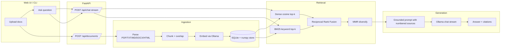

# RAGForge — Local RAG Studio

A fully local, from-scratch Retrieval-Augmented Generation application powered by
Ollama. Built to be **understood**, not just run: every stage of the pipeline
(ingestion, chunking, embedding, indexing, retrieval, prompting, streaming) is
small, readable Python with no LangChain magic.

## Why this project

Most RAG demos hide the interesting parts behind a framework. RAGForge is a
teaching-grade reference implementation that still looks and feels like a real
product:

- **Zero cloud calls.** Documents never leave the machine.
- **From scratch.** Hybrid retrieval (dense + BM25 + reciprocal rank fusion),
  MMR, citation-aware prompting — all implemented directly.
- **Showcase ready.** Polished streaming chat UI, document manager, source
  inspector, tests, CLI, and architecture docs.
- **Hardware aware.** Defaults chosen for a 6 GB laptop GPU; any Ollama model
  can be selected at runtime.

## Target environment

| Component | Value |
|-----------|-------|
| OS | Windows 11 + WSL2 (Ubuntu) |
| CPU | Intel i5-13450HX (16 cores) |
| RAM | 7.6 GB |
| GPU | NVIDIA RTX 3050 6 GB (CUDA) |
| Runtime | Ollama on Windows, app in WSL2 |
| Chat models | `qwen2.5-coder:3b-instruct-q8_0`, `my-custom-qwen:latest`, `Gemma-4-E4B-Uncensored...:Q4_K_M` |
| Embedding model | `nomic-embed-text` (768-d), fallback `all-minilm` (384-d) |

## Architecture



### Pipeline stages

1. **Parse** — extract plain text per page/section with `pypdf`, `python-docx`,
   `beautifulsoup4`, or plain read. Preserve page numbers for citations.
2. **Chunk** — sentence-aware sliding window with configurable size and overlap.
   Each chunk keeps `document_id`, `page`, `chunk_index`, and offsets.
3. **Embed** — batch call to Ollama `/api/embed` using an embedding model.
   Vectors are stored as float32 BLOBs in SQLite.
4. **Index** — SQLite tables for documents, chunks, and a small meta table that
   records the embedder name + dimension so mismatched indexes are detected.
5. **Retrieve** — dense cosine similarity and a pure-Python BM25 index are
   combined with Reciprocal Rank Fusion, then diversified with MMR.
6. **Generate** — a grounded prompt lists numbered sources, instructs the model
   to cite `[n]`, and to say it does not know when context is insufficient.
   Tokens stream to the browser over Server-Sent Events.

## Stack

- **Backend:** Python 3.12, FastAPI, Uvicorn, httpx, numpy, pydantic-settings
- **Parsing:** pypdf, python-docx, beautifulsoup4
- **Storage:** SQLite (stdlib) + numpy cosine — no vector DB service required
- **Frontend:** vanilla HTML/CSS/JS, SSE streaming, no build step
- **Tooling:** uv, pytest, ruff

No LangChain / LlamaIndex on purpose: the goal is to show the mechanics.

## Features

- Drag-and-drop upload for PDF, TXT, Markdown, DOCX, HTML
- Persistent document library with chunk/character counts and delete
- Streaming answers with inline `[n]` citations
- Source inspector showing retrieved chunk text, document, page, and scores
- Hybrid retrieval (dense + BM25 + RRF) with MMR diversification
- Runtime controls: chat model, embedding model, top-k, temperature, chunk size
- Ollama health/model discovery in the UI
- CLI: `ragforge ingest`, `ragforge ask`, `ragforge serve`
- Tests for chunking, BM25, vector math, RRF, and ingestion

## API surface

| Method | Path | Purpose |
|--------|------|---------|
| GET | `/api/health` | App + Ollama status, embedder info |
| GET | `/api/models` | List installed Ollama models |
| GET | `/api/documents` | List indexed documents |
| POST | `/api/documents` | Upload + ingest a file |
| DELETE | `/api/documents/{id}` | Delete a document and its chunks |
| POST | `/api/search` | Retrieve chunks without generating |
| POST | `/api/chat` | SSE stream: answer tokens + sources |
| GET | `/api/stats` | Counts and index metadata |

## Build phases

1. **Foundation** — project scaffold, config, Ollama client, connectivity check.
2. **Ingestion** — parsers, chunker, embeddings, SQLite store.
3. **Retrieval** — cosine, BM25, RRF, MMR, tests.
4. **Generation** — grounded prompt, streaming chat, citation handling.
5. **Experience** — API endpoints, polished web UI, CLI.
6. **Polish** — README, screenshots, tests, lint, end-to-end verification.

## WSL ↔ Windows Ollama networking

Ollama on Windows binds to `127.0.0.1` by default, which WSL2 cannot reach.
RAGForge reads `OLLAMA_BASE_URL`, and the setup script configures Ollama to
listen on all interfaces so WSL can connect through the host gateway.

```powershell
setx OLLAMA_HOST "0.0.0.0:11434"   # then restart Ollama
ollama pull nomic-embed-text
```

Security note: binding to `0.0.0.0` exposes Ollama to the local network. On
trusted networks this is fine; otherwise restrict with a Windows Firewall rule
or set `OLLAMA_HOST` to the WSL-facing vEthernet IP.

## Non-goals

- Multi-tenant auth, cloud deployment, or horizontal scaling
- Re-ranking with a cross-encoder (possible future extension)
- OCR for scanned PDFs (future extension)

## Definition of done

- `uv run ragforge serve` starts and the UI loads
- Upload a PDF/Markdown file and see it indexed
- Ask a question and receive a streaming, cited answer
- Sources panel shows the exact chunks used
- `uv run pytest` and `uv run ruff check` pass
- README explains setup, architecture, and demo flow
