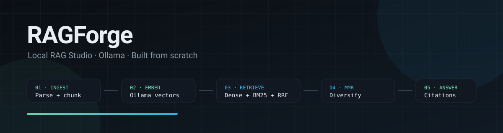
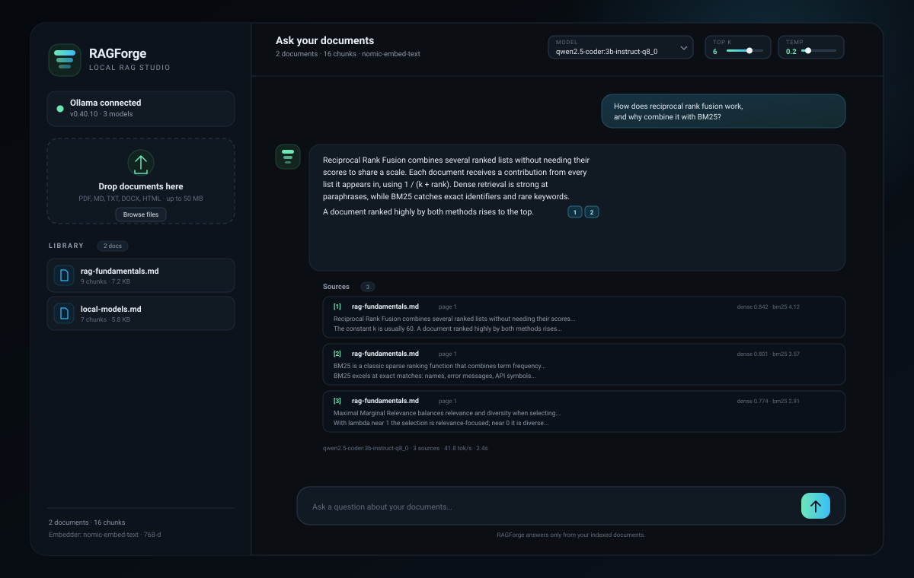
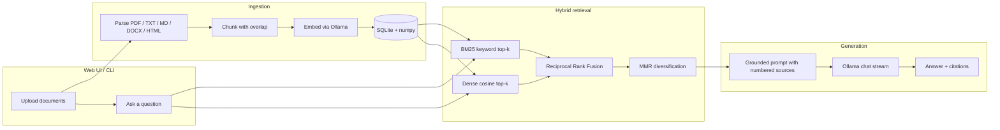

# RAGForge

**A fully local Retrieval-Augmented Generation studio you can read, understand, and extend.**

[](https://www.python.org/)
[](https://fastapi.tiangolo.com/)
[](https://ollama.com/)
[](LICENSE)



RAGForge is a from-scratch RAG application: document parsing, chunking,
embeddings, a hybrid dense + BM25 retriever, reciprocal rank fusion, MMR
diversification, citation-aware prompting, and streaming answers — all in small,
readable Python. No LangChain, no LlamaIndex, no cloud calls.

Your documents and your models stay on your machine.

> **Deep dive:** [How RAGForge works](docs/HOW_IT_WORKS.md) walks through every
> stage of the pipeline — parsing, chunking, embeddings, BM25, RRF, MMR,
> prompting, streaming, the API, and the design trade-offs.

---

## Highlights

- **100% local** — Ollama for chat and embeddings; documents never leave the box.
- **From scratch** — every pipeline stage is implemented directly, not hidden.
- **Hybrid retrieval** — dense cosine similarity + BM25 keyword search fused with
  Reciprocal Rank Fusion, then diversified with MMR.
- **Grounded answers** — numbered sources, inline `[n]` citations, and a strict
  "say you don't know" system prompt.
- **Streaming UI** — drag-and-drop uploads, live token streaming, and a source
  inspector that shows exactly which chunks were used.
- **Works on small hardware** — tuned for a 6 GB laptop GPU; any Ollama model can
  be selected at runtime.
- **CLI included** — ingest, ask, list, check, and reset without opening a browser.
- **Tested** — unit tests for chunking, BM25, RRF, MMR, and the vector store.

## Interface preview



## Architecture



### How the pipeline works

1. **Parse** — `pypdf`, `python-docx`, and `BeautifulSoup` extract text per page
   so citations can point at a page number.
2. **Chunk** — a boundary-aware sliding window cuts on paragraphs or sentences
   when possible, with configurable size and overlap.
3. **Embed** — chunk text is batched through Ollama's `/api/embed` endpoint and
   L2-normalized, so cosine similarity is a dot product.
4. **Store** — documents, chunks, and float32 vectors live in SQLite. No external
   vector database to install. An in-process cache keeps retrieval fast.
5. **Retrieve** — dense cosine and BM25 rankings are fused with RRF; MMR removes
   near-duplicate chunks while preserving relevance.
6. **Generate** — the top chunks become numbered sources in a grounded prompt.
   Tokens stream to the browser over Server-Sent Events, and the UI renders the
   sources beside the answer.

### Read the pipeline

If you want to learn RAG by reading code, follow this path:

| Concept | Start here |
|---|---|
| Ollama endpoint discovery (including WSL2) | `ragforge/ollama_client.py` → `candidate_base_urls`, `resolve_base_url` |
| PDF / DOCX / HTML / text extraction | `ragforge/parsing.py` → `parse_file` |
| Boundary-aware chunking with overlap | `ragforge/chunking.py` → `chunk_text` |
| Embeddings, normalization, offline fallback | `ragforge/embeddings.py` → `EmbeddingService`, `HashingEmbedder` |
| SQLite schema and vector cache | `ragforge/store.py` → `VectorStore` |
| Cosine similarity and BM25 | `ragforge/retrieval.py` → `cosine_similarities`, `bm25_scores` |
| Reciprocal Rank Fusion | `ragforge/retrieval.py` → `reciprocal_rank_fusion` |
| MMR diversification | `ragforge/retrieval.py` → `maximal_marginal_relevance` |
| Grounded prompt and context budget | `ragforge/rag.py` → `build_messages`, `select_context` |
| Streaming API | `ragforge/api.py` → `chat` and `event_stream` |
| Browser streaming and citations | `ragforge/static/app.js` → `readSSE`, `renderMarkdown` |

## Quickstart

### 0. Prerequisites

- [Ollama](https://ollama.com/download) installed and running.
- Python 3.11+ and [uv](https://docs.astral.sh/uv/).
- A chat model and an embedding model:

```bash
ollama pull qwen2.5-coder:3b-instruct-q8_0
ollama pull nomic-embed-text
```

### 1. Clone and install

```bash
git clone https://github.com/<your-username>/ragforge.git
cd ragforge
uv sync --extra dev
```

### 2. Connect Ollama

If the app and Ollama run on the same machine, nothing to do — RAGForge
auto-detects `http://localhost:11434`.

**Windows + WSL2:** Ollama listens on Windows `127.0.0.1` by default, which WSL2
cannot reach. In a Windows PowerShell window:

```powershell
./scripts/setup_ollama.ps1
```

The script sets `OLLAMA_HOST=0.0.0.0:11434`, restarts Ollama, and pulls
`nomic-embed-text`. Then, from WSL:

```bash
uv run ragforge check
```

RAGForge tries `localhost`, `127.0.0.1`, and the default gateway (the Windows
host) automatically. You can also pin it explicitly:

```bash
export OLLAMA_BASE_URL=http://$(ip route show default | awk '{print $3}'):11434
```

> **Security note:** binding Ollama to `0.0.0.0` exposes it to your local network.
> On untrusted networks, add a firewall rule or bind to the WSL-facing address.

### 3. Run

```bash
uv run ragforge serve
```

Open <http://127.0.0.1:8000>, drop in a PDF or Markdown file, and ask a question.

Or use the CLI:

```bash
uv run ragforge ingest samples
uv run ragforge ask "What is reciprocal rank fusion?" --sources
```

## Usage

### Web UI

- Drag files onto the upload panel or click to browse.
- Select a chat model, top-k, and temperature in the toolbar.
- Ask a question. The answer streams in with `[n]` citations.
- Expand **Sources** under an answer to inspect the exact chunks, pages, and
  dense/BM25 scores.
- Delete a document or reset the whole index from the sidebar.

### CLI

```bash
ragforge serve [--host 0.0.0.0] [--port 8000] [--reload]
ragforge check
ragforge ingest path/to/file.pdf path/to/folder
ragforge ask "your question" [--model NAME] [--top-k N] [--sources]
ragforge docs
ragforge models
ragforge reset [--yes]
```

## Configuration

Copy `.env.example` to `.env` and edit as needed.

| Variable | Default | Description |
|---|---|---|
| `OLLAMA_BASE_URL` | auto | Ollama endpoint; empty means auto-detect |
| `RAGFORGE_CHAT_MODEL` | `qwen2.5-coder:3b-instruct-q8_0` | Default chat model |
| `RAGFORGE_EMBED_MODEL` | `nomic-embed-text` | Embedding model |
| `RAGFORGE_ALLOW_FALLBACK_EMBEDDINGS` | `true` | Use a local hashing embedder if Ollama embeddings fail |
| `RAGFORGE_DATA_DIR` | `data` | SQLite database and uploads |
| `RAGFORGE_CHUNK_SIZE` | `900` | Chunk size in characters |
| `RAGFORGE_CHUNK_OVERLAP` | `150` | Overlap between chunks |
| `RAGFORGE_TOP_K` | `6` | Chunks passed to the model |
| `RAGFORGE_DENSE_K` | `12` | Dense candidates before fusion |
| `RAGFORGE_BM25_K` | `12` | BM25 candidates before fusion |
| `RAGFORGE_MMR_LAMBDA` | `0.8` | Relevance vs. diversity trade-off |
| `RAGFORGE_TEMPERATURE` | `0.2` | Sampling temperature |
| `RAGFORGE_MAX_CONTEXT_CHARS` | `12000` | Context budget |
| `RAGFORGE_NUM_CTX` | `8192` | Ollama context window |

> The embedding model is fixed per index. If you change
> `RAGFORGE_EMBED_MODEL`, reset the index and re-ingest so query and document
> vectors share the same space.

## API

| Method | Endpoint | Description |
|---|---|---|
| `GET` | `/api/health` | Ollama status, models, index metadata |
| `GET` | `/api/models` | Installed Ollama models |
| `GET` | `/api/documents` | List indexed documents |
| `POST` | `/api/documents` | Upload and ingest files (multipart `files`) |
| `DELETE` | `/api/documents/{id}` | Delete a document and its chunks |
| `POST` | `/api/search` | Retrieve chunks without generating |
| `POST` | `/api/chat` | Stream a grounded answer (SSE) |
| `GET` | `/api/stats` | Counts and embedder info |
| `POST` | `/api/admin/reset` | Wipe the index |

Interactive docs are available at <http://127.0.0.1:8000/docs>.

## Project structure

```text
ragforge/
├── ragforge/
│   ├── api.py            FastAPI app, uploads, SSE streaming
│   ├── chunking.py       Boundary-aware sliding-window chunker
│   ├── cli.py            ragforge command-line interface
│   ├── config.py         Environment-driven settings
│   ├── embeddings.py     Ollama embedder + offline hashing fallback
│   ├── ingest.py         Parse → chunk → embed → store
│   ├── ollama_client.py  Async Ollama HTTP client + endpoint discovery
│   ├── parsing.py        PDF / DOCX / HTML / text extraction
│   ├── rag.py            Grounded prompt, context selection, streaming
│   ├── retrieval.py      Cosine, BM25, RRF, MMR
│   ├── store.py          SQLite document + vector store
│   └── static/           Vanilla HTML/CSS/JS UI
├── samples/              Demo documents (ingest these first)
├── docs/                 Banner, interface preview, and HOW_IT_WORKS.md deep dive
├── scripts/              Windows Ollama setup + WSL host discovery
├── tests/                Unit tests
├── PLAN.md               Build plan and design notes
└── pyproject.toml
```

## Testing

```bash
uv run pytest
uv run ruff check .
```

The tests cover chunk boundaries and overlap, BM25 ranking, reciprocal rank
fusion, MMR selection, and SQLite store lifecycle without needing a running
Ollama.

## Troubleshooting

**`Could not reach Ollama`**
- Confirm `ollama list` works in a terminal.
- On Windows + WSL2, run `scripts/setup_ollama.ps1`, then `uv run ragforge check`.
- Check that port 11434 is listening: `curl http://<host>:11434/api/version`.

**`model requires more system memory`**
- Pick a smaller model in the toolbar, or reduce `RAGFORGE_NUM_CTX`.
- `llmfit fit` can suggest models that fit your hardware.

**`Embedding model ... did not return embeddings`**
- Pull an embedding model: `ollama pull nomic-embed-text`.
- Or set `RAGFORGE_ALLOW_FALLBACK_EMBEDDINGS=true` to use the offline hashing
  embedder (lower quality, but zero setup).

**Changing the embedding model breaks search**
- Reset and re-ingest: `uv run ragforge reset --yes && uv run ragforge ingest samples`.

## Roadmap

- Cross-encoder re-ranking
- OCR for scanned PDFs
- Conversation-aware query rewriting
- Per-document metadata filters in the UI
- Retrieval evaluation harness (recall@k, MRR)
- Optional Chroma/pgvector backends behind the same store interface

## License

MIT — see [LICENSE](LICENSE).
