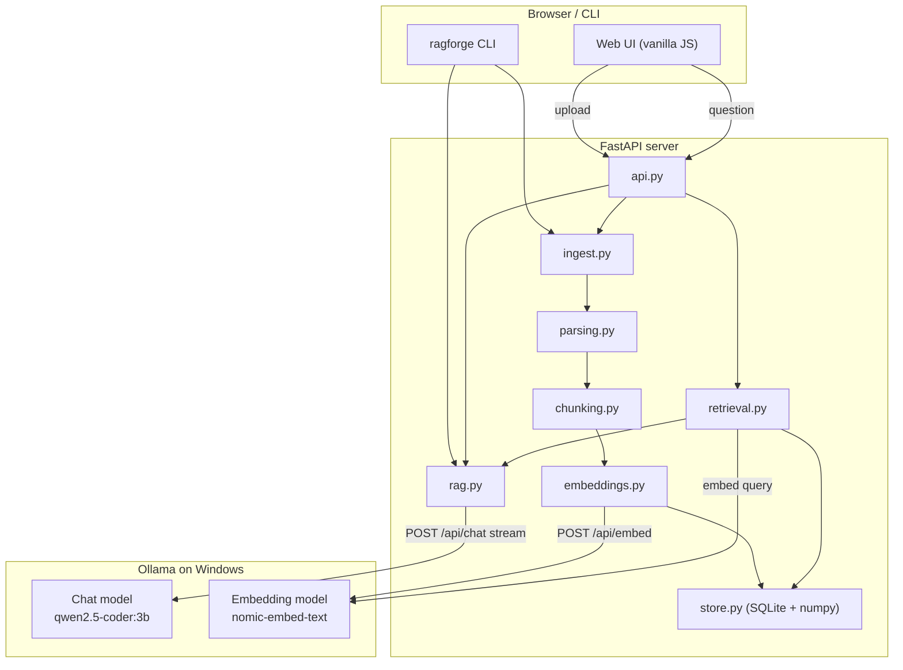
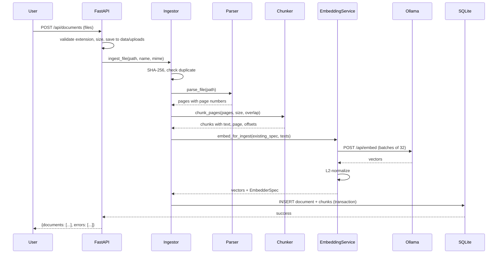
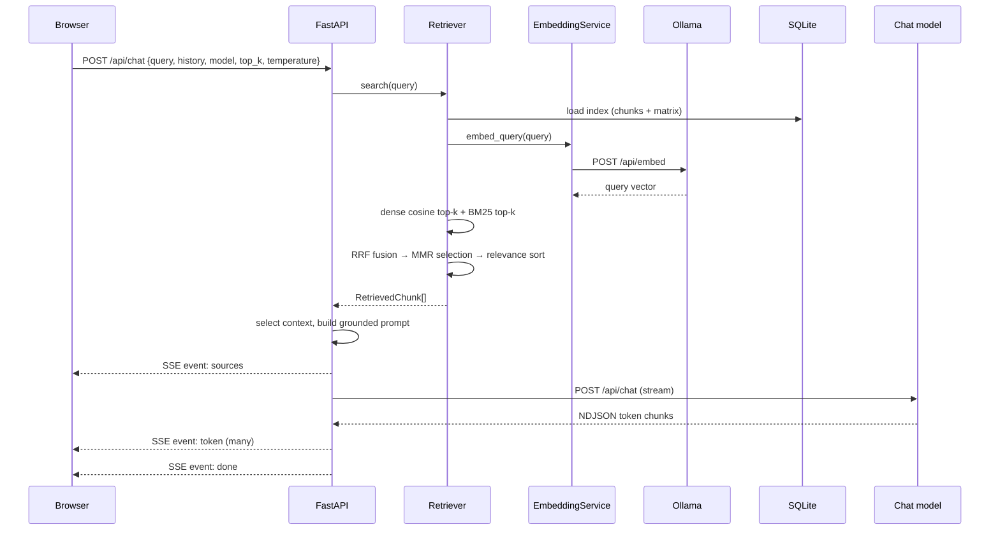

# RAGForge — How It Works

A complete walkthrough of the project: what each component does, why it exists,
how data moves through the system, and how to explain it to someone else.

This document is the companion to [README.md](../README.md). The README is the
quick start; this is the deep dive.

---

## 1. The one-paragraph explanation

RAGForge is a fully local Retrieval-Augmented Generation application. You upload
documents, the app extracts and chunks their text, converts each chunk into a
vector with an Ollama embedding model, and stores the vectors in SQLite. When
you ask a question, the app embeds the question, retrieves the most relevant
chunks using both dense vector similarity and BM25 keyword search, fuses those
rankings with Reciprocal Rank Fusion, removes near-duplicates with MMR, and
sends the selected chunks to a local Ollama chat model as numbered sources. The
model streams an answer back with `[n]` citations, and the UI shows exactly
which chunks were used.

Everything runs on your machine. No cloud APIs, no external vector database, no
LangChain.

---

## 2. The problem RAG solves

### 2.1 Why not just ask the model?

A language model only knows what is in its training data and its current prompt.
It does not know your private notes, your company wiki, a PDF you downloaded
today, or the contents of your codebase. If you ask about those things, it may:

- say it does not know, or
- hallucinate a confident but wrong answer.

Fine-tuning can teach a model a style or a domain, but it is expensive, slow to
update, and still not a reliable way to recall exact facts. Retrieval is better
when the knowledge changes often or must be traceable.

### 2.2 What RAG adds

RAG adds a search step before generation:

1. Find passages relevant to the question.
2. Put those passages into the prompt.
3. Instruct the model to answer only from them and cite them.

This gives three practical benefits:

- **Freshness** — update the document index, not the model.
- **Privacy** — documents and inference stay local.
- **Traceability** — every claim can point to a source chunk.

### 2.3 Why local?

The project targets a laptop with a 6 GB GPU. Local inference avoids API costs,
works offline, and keeps sensitive documents on-device. Ollama provides a simple
HTTP API for both chat and embeddings, so the application does not need to manage
model weights directly.

---

## 3. System at a glance

### 3.1 Component diagram



### 3.2 File map

| File | Responsibility | Key entry points |
|---|---|---|
| `ragforge/config.py` | Environment-driven settings | `Settings`, `settings` |
| `ragforge/ollama_client.py` | Async Ollama HTTP client and endpoint discovery | `OllamaClient`, `candidate_base_urls` |
| `ragforge/parsing.py` | Extract text from PDF, DOCX, HTML, text/code files | `parse_file`, `Page`, `ParsedDocument` |
| `ragforge/chunking.py` | Boundary-aware sliding-window chunker | `chunk_text`, `chunk_pages` |
| `ragforge/embeddings.py` | Embedding specs, normalization, Ollama embeddings, offline fallback | `EmbeddingService`, `HashingEmbedder`, `EmbedderSpec` |
| `ragforge/store.py` | SQLite schema, document/chunk persistence, vector cache | `VectorStore`, `DocumentRecord`, `ChunkRecord` |
| `ragforge/ingest.py` | Orchestrates parse → chunk → embed → store | `Ingestor.ingest_file` |
| `ragforge/retrieval.py` | Cosine, BM25, RRF, MMR, retrieval pipeline | `Retriever.search`, `bm25_scores`, `reciprocal_rank_fusion`, `maximal_marginal_relevance` |
| `ragforge/rag.py` | Context selection, grounded prompt, streaming events | `RAGPipeline.stream`, `build_messages` |
| `ragforge/api.py` | FastAPI app, uploads, search, SSE chat, admin | `create_app`, `chat`, `upload_documents` |
| `ragforge/cli.py` | Terminal commands | `main`, `_ingest`, `_ask` |
| `ragforge/static/` | Web UI | `app.js`, `styles.css`, `index.html` |
| `tests/` | Unit tests that do not require Ollama | `test_chunking.py`, `test_retrieval.py`, `test_store.py`, `test_ingest.py` |
| `samples/` | Demo documents used for the walkthrough | `rag-fundamentals.md`, `local-models.md` |

### 3.3 Ingestion lifecycle



### 3.4 Question lifecycle



---

## 4. Ingestion pipeline in detail

### 4.1 Upload and validation

The upload endpoint is `POST /api/documents` in `ragforge/api.py`. It accepts a
multipart form with one or more files under the field name `files`.

For each file:

1. **Sanitize the filename** with `Path(filename).name` so a name like
   `../../etc/passwd` cannot escape the upload directory.
2. **Check the extension** against `SUPPORTED_EXTENSIONS` from
   `ragforge/parsing.py`.
3. **Check the size** against `RAGFORGE_MAX_UPLOAD_MB` (default 50 MB).
4. **Save** the bytes to `data/uploads/<uuid><extension>`. A UUID name avoids
   collisions and avoids trusting user-supplied paths.
5. **Ingest** the saved file.
6. On failure or duplicate, delete the saved file and return a per-file error.

The response is always structured as:

```json
{
  "documents": [ { "id": "...", "name": "...", "num_chunks": 7, ... } ],
  "errors": [ { "file": "bad.exe", "error": "Unsupported file type '.exe'." } ]
}
```

This lets the UI show partial success: three files can succeed while one fails.

### 4.2 Parsing

`ragforge/parsing.py` converts a file into a list of `Page` objects:

```python
@dataclass(frozen=True)
class Page:
    number: int
    text: str
```

Why pages? Citations. A PDF chunk can point to page 7, not just “somewhere in the
document.” Formats without pages (Markdown, DOCX, text) use page 1.

| Format | Parser | Behavior |
|---|---|---|
| `.pdf` | `pypdf.PdfReader` | Extracts text page by page; rejects encrypted PDFs; raises a clear error for scanned PDFs with no text |
| `.docx` | `python-docx` | Paragraphs plus table rows; page 1 |
| `.html`, `.htm` | `BeautifulSoup` | Removes `script`, `style`, `noscript`, `template`; extracts text |
| Text/code | `Path.read_text` | UTF-8 with replacement; supports `.md`, `.txt`, `.csv`, `.json`, `.py`, `.js`, `.sql`, `.yaml`, and more |

`clean_text` normalizes line endings, strips trailing whitespace per line, and
collapses three or more newlines into two. It deliberately does **not** collapse
indentation, so code and Markdown structure survive.

If no extractable text is found, parsing raises `ParseError` and the upload is
rejected with a helpful message.

### 4.3 Chunking

`ragforge/chunking.py` implements a boundary-aware sliding window.

Why chunk at all? A model has a finite context window, and embeddings represent
a passage, not a whole book. Chunks should be small enough to be specific but
large enough to contain a complete idea.

Default parameters:

| Parameter | Default | Meaning |
|---|---|---|
| `chunk_size` | 900 | Target maximum characters per chunk |
| `chunk_overlap` | 150 | Characters of overlap between consecutive chunks |
| `min_chunk_chars` | 40 | Tiny pieces below this are merged or dropped |

Algorithm (`chunk_text`):

1. Clean the text.
2. Start at character 0. The candidate window is `[start, start + size]`.
3. If the window ends before the document ends, look for a boundary in the
   **latter 55%** of the window. Boundaries considered are paragraph breaks,
   `. `, `! `, `? `, and newlines.
4. If a boundary is found, cut there. Otherwise, cut at the last whitespace in
   the second half of the window. If there is no whitespace, hard-cut at `size`.
5. Emit the chunk if it is at least `min_chars`.
6. Move the next start to `end - overlap`, then advance to the next whitespace
   so the next chunk does not begin mid-word.
7. If the final piece is tiny, merge it into the previous chunk.

This is a pragmatic middle ground: sentence-aware when possible, robust when
not. It guarantees forward progress, so even text with no spaces terminates.

`chunk_pages` runs the same logic per page and then renumbers all chunks with a
single contiguous global index. Each `TextChunk` stores:

- `index` — global chunk number within the document
- `text`
- `start` / `end` — approximate character offsets
- `page` — page number for citations

**Trade-offs**

- Larger chunks preserve more context but dilute the embedding and use more of
  the model's context window.
- More overlap reduces the chance of splitting an idea, but increases storage
  and embedding cost.
- 900/150 is a reasonable default for prose. Code-heavy corpora may benefit from
  smaller chunks or syntax-aware splitting.

### 4.4 Embeddings

`ragforge/embeddings.py` handles the vector representation.

#### Embedder specification

An index is tied to one embedding space. The app records an `EmbedderSpec`:

```python
@dataclass(frozen=True)
class EmbedderSpec:
    kind: str      # "ollama" or "local"
    model: str     # e.g. "nomic-embed-text" or "hashing"
    dim: int       # e.g. 768 or 512
```

Its `id` looks like `ollama:nomic-embed-text:768` or `local:hashing:512`.

This spec is stored in the `meta` table. Queries always use the **indexed**
spec, not whatever the current environment says, so document and query vectors
stay compatible.

#### Ollama embeddings

`EmbeddingService.embed_with_spec` calls `OllamaClient.embed`, which posts to
Ollama's `/api/embed` endpoint in batches of 32:

```json
{ "model": "nomic-embed-text", "input": ["chunk 1", "chunk 2"], "truncate": true }
```

The response contains one vector per input. Every vector is L2-normalized:

```python
vector = vector / ||vector||
```

Once normalized, cosine similarity is just a dot product, which makes retrieval
a single matrix multiply.

#### Offline fallback

If Ollama embeddings fail and `RAGFORGE_ALLOW_FALLBACK_EMBEDDINGS=true`, the app
uses `HashingEmbedder`:

- Tokenizes lowercased words and character trigrams.
- Hashes each feature with BLAKE2b into one of 512 dimensions.
- Adds a signed weight (words weight 1.0, trigrams 0.35).
- L2-normalizes the result.

This is deterministic and needs no model, so the demo still works offline. It is
much lower quality than a real embedding model and is intended as a safety net,
not a default.

#### Embedding-model changes

If the index already uses an Ollama embedder and the configured
`RAGFORGE_EMBED_MODEL` differs, ingestion raises `EmbedderMismatch` with a clear
message. Mixing embedding spaces silently would make similarity meaningless.
The fix is to reset the index and re-ingest:

```bash
uv run ragforge reset --yes
uv run ragforge ingest samples
```

### 4.5 Persistence

`ragforge/store.py` is a SQLite-backed store. SQLite was chosen because it is in
the Python standard library, requires no server, and is easy to inspect.

#### Schema

```sql
CREATE TABLE documents (
    id TEXT PRIMARY KEY,
    name TEXT NOT NULL,
    sha256 TEXT NOT NULL,
    size_bytes INTEGER NOT NULL,
    num_chunks INTEGER NOT NULL,
    num_chars INTEGER NOT NULL,
    created_at TEXT NOT NULL,
    embedder TEXT NOT NULL,
    dim INTEGER NOT NULL,
    source_path TEXT,
    mime TEXT
);

CREATE UNIQUE INDEX idx_documents_sha ON documents(sha256);

CREATE TABLE chunks (
    id TEXT PRIMARY KEY,
    document_id TEXT NOT NULL REFERENCES documents(id) ON DELETE CASCADE,
    chunk_index INTEGER NOT NULL,
    page INTEGER NOT NULL,
    text TEXT NOT NULL,
    start_offset INTEGER NOT NULL,
    end_offset INTEGER NOT NULL,
    embedding BLOB NOT NULL
);

CREATE INDEX idx_chunks_document ON chunks(document_id);

CREATE TABLE meta (
    key TEXT PRIMARY KEY,
    value TEXT NOT NULL
);
```

Key details:

- **SHA-256 deduplication** — the unique index on `documents.sha256` and an
  explicit `find_by_sha` check prevent uploading the same file twice.
- **Embeddings as BLOBs** — each vector is stored as a float32 byte string. This
  is compact and avoids JSON overhead.
- **Foreign key cascade** — deleting a document deletes its chunks.
- **WAL mode** — better read/write concurrency for a local app.
- **One connection per operation** — simple and thread-safe for this workload.
- **In-memory cache** — `load_index()` caches the chunk list and matrix until a
  write increments the version counter. Retrieval avoids re-reading and
  re-stacking vectors on every query.

#### Data model

`DocumentRecord` holds metadata and counts. `ChunkRecord` holds the chunk text,
page, offsets, and decoded `numpy` vector. `to_dict()` produces the JSON shape
the UI consumes.

---

## 5. Retrieval in detail

Retrieval is in `ragforge/retrieval.py`. It combines two complementary signals.

### 5.1 Dense retrieval (cosine similarity)

Each chunk and the query are normalized vectors. The dense score is:

```
cos(q, d) = q · d
```

because both vectors have unit length. The code computes all scores at once:

```python
scores = matrix @ query_vector
```

The top `RAGFORGE_DENSE_K` (default 12) chunks become the dense ranking.

**Strengths:** synonyms, paraphrases, conceptual similarity.
**Weaknesses:** exact identifiers, rare names, error codes, numbers.

### 5.2 BM25 keyword retrieval

BM25 is a sparse ranking function. For a query with terms `t`:

```
score(D, Q) = Σ_t IDF(t) · (f(t, D) · (k1 + 1))
              / (f(t, D) + k1 · (1 - b + b · |D| / avgdl))

IDF(t) = ln(1 + (N - n(t) + 0.5) / (n(t) + 0.5))
```

Defaults: `k1 = 1.5`, `b = 0.75`.

- `f(t, D)` is term frequency in the chunk.
- `n(t)` is the number of chunks containing the term.
- `N` is the number of chunks.
- `|D|` is chunk length; `avgdl` is average chunk length.

The implementation in `bm25_scores` builds `Counter` objects per chunk, computes
document frequencies, and scores every query term. Only chunks with a positive
score enter the BM25 ranking. The top `RAGFORGE_BM25_K` (default 12) are kept.

**Strengths:** exact matches, names, API symbols, error messages.
**Weaknesses:** no semantics; a synonym is a different token.

The tokenizer is intentionally simple: lowercase `[a-z0-9_]+`. It does not stem.
That is a deliberate trade-off: predictable behavior and zero dependencies.

### 5.3 Reciprocal Rank Fusion

Dense and BM25 scores are not on the same scale. RRF solves this by using only
ranks:

```
RRF(d) = Σ_{r ∈ rankings} 1 / (k + rank_r(d))
```

The constant `k` is 60 in this project. A document that appears in both lists
accumulates two contributions; a document that appears in only one still gets a
contribution. This is why RRF is a strong, low-maintenance hybrid fusion method.

Example: a chunk ranked #1 by dense and #3 by BM25 scores
`1/(60+1) + 1/(60+3) ≈ 0.0323`. A chunk ranked #1 by only one method scores
`≈ 0.0164`.

### 5.4 Maximal Marginal Relevance

RRF can return several near-duplicate chunks. MMR selects a final set that is
relevant but not redundant:

```
MMR = argmax_{d ∈ R \ S} [ λ · sim(q, d)
                           - (1 - λ) · max_{s ∈ S} sim(d, s) ]
```

- `S` is the already-selected set.
- `R` is the candidate pool.
- `λ` is `RAGFORGE_MMR_LAMBDA` (default 0.8).

The first selection is the most query-similar candidate. Each subsequent
selection balances query relevance against similarity to already-selected
chunks. With `λ = 0.8`, relevance dominates but exact duplicates are still
penalized.

The candidate pool is the top `max(top_k * 4, top_k)` chunks by RRF score. MMR
selects `top_k` from that pool.

### 5.5 Relevance ordering

After MMR selects the set, the code re-sorts the selected chunks by their RRF
score, descending. This is important for citation quality: MMR chooses a diverse
set, but the prompt should present the most relevant evidence first, as source
`[1]`, `[2]`, and so on. Without this re-sort, a diverse but weakly relevant
chunk could appear early and confuse both the reader and the model.

### 5.6 Worked example from the demo

Query: **“What is reciprocal rank fusion and why combine it with BM25?”**

The demo index returns (after ordering):

| Source | Document | Chunk | Dense | BM25 | What it contains |
|---|---|---|---|---|---|
| `[1]` | `rag-fundamentals.md` | 3 | 0.7617 | 12.6073 | BM25 section and start of RRF |
| `[2]` | `rag-fundamentals.md` | 2 | 0.5126 | 4.3830 | Chunking and the start of BM25 |
| `[3]` | `rag-fundamentals.md` | 4 | 0.5572 | 2.8664 | RRF formula and explanation |
| `[4]` | `rag-fundamentals.md` | 0 | 0.5174 | 0.8839 | RAG overview |
| `[5]` | `rag-fundamentals.md` | 6 | 0.4656 | 0.2155 | Common failure modes |
| `[6]` | `local-models.md` | 4 | 0.4621 | 0.0726 | Practical defaults and WSL notes |

Why this shape?

- Chunk 3 wins BM25 because it contains the exact query terms and the BM25
  section.
- Chunk 4 contains the actual RRF formula, so it is strongly dense-relevant and
  also BM25-relevant.
- Chunk 2 is adjacent context; RRF and MMR keep it because it overlaps the
  topic.
- Chunk 6 is the weakest; it survives because the candidate pool is wider than
  `top_k` and MMR prefers some diversity. It is placed last.

The model can then answer from `[3]` and cite it correctly. The UI shows all six
sources with their dense and BM25 scores so a human can verify the retrieval.

---

## 6. Generation in detail

### 6.1 Context selection

`ragforge/rag.py::select_context` walks the retrieved chunks in order and builds
numbered source blocks:

```
[1] document: rag-fundamentals.md, page 1
<chunk text>

[2] document: local-models.md, page 1
<chunk text>
```

It stops adding sources when the next block would exceed
`RAGFORGE_MAX_CONTEXT_CHARS` (default 12,000 characters). The source numbering in
the prompt matches the source numbering in the UI exactly.

### 6.2 Prompt construction

`build_messages` produces:

1. A **system message** with strict grounding rules.
2. Up to the last `RAGFORGE_MAX_HISTORY_MESSAGES` (default 6) user/assistant
   turns from the conversation history, each truncated to 4,000 characters.
3. A **user message** containing the numbered sources, the question, and the
   instruction to cite sources inline.

The system prompt is deliberately explicit:

- Answer only from the numbered sources.
- If the sources are insufficient, say so.
- Do not use outside knowledge.
- Cite every factual sentence and bullet with `[n]`.
- Never invent citations.
- Use plain text for formulas, not LaTeX.
- Be concise and well structured.

The prompt is not a hard guarantee. Models can still miss a citation or cite the
wrong number. The UI is designed to make that visible: sources are shown with
scores and text, and citations are clickable.

### 6.3 Streaming

`RAGPipeline.stream` is an async generator that yields application events:

```python
{"type": "sources", "sources": [...]}
{"type": "token", "content": "Reciprocal"}
{"type": "token", "content": " Rank"}
...
{"type": "done", "model": "...", "retrieved": 6, "eval_count": 123, ...}
```

If retrieval returns nothing, the pipeline yields an empty `sources` event, a
helpful “I could not find relevant content” token, and a `done` event. It does
not call the model with no context, which avoids ungrounded answers.

The Ollama client (`chat_stream`) reads Ollama's newline-delimited JSON stream
and yields decoded chunks. The FastAPI endpoint wraps each application event as
Server-Sent Events:

```
data: {"type":"token","content":"Reciprocal"}\n\n
```

The browser parses this with `fetch` + `ReadableStream`, not `EventSource`,
because the request is a POST with a JSON body.

### 6.4 Citations

Citations are a three-part feature:

1. **Prompt** — numbered sources and an instruction to cite them.
2. **Transport** — the `sources` SSE event contains the same numbers and the
   chunk metadata.
3. **UI** — `renderMarkdown` turns `[3]` into a clickable button. Clicking it
   opens the Sources panel and highlights source 3.

The source object includes:

```json
{
  "n": 3,
  "chunk_id": "...",
  "document_id": "...",
  "document": "rag-fundamentals.md",
  "page": 1,
  "chunk_index": 4,
  "text": "...",
  "scores": { "dense": 0.5572, "bm25": 2.8664, "rrf": 0.032258 }
}
```

### 6.5 Conversation history

The UI keeps the last 12 messages in `state.history` and sends the last 6 as
`history` with each chat request. The server prepends them as user/assistant
messages before the current grounded question. This allows follow-up questions
without re-explaining the topic. The current question is always the final user
message and always includes fresh retrieved context.

---

## 7. API and streaming protocol

### 7.1 Endpoints

| Method | Path | Request | Response |
|---|---|---|---|
| `GET` | `/` | — | The web UI |
| `GET` | `/api/health` | — | Ollama status, models, config, index counts, embedder |
| `GET` | `/api/models` | — | Installed Ollama models |
| `GET` | `/api/documents` | — | All indexed documents |
| `POST` | `/api/documents` | multipart `files` | `{documents, errors}` |
| `DELETE` | `/api/documents/{id}` | — | `{deleted, id}` |
| `POST` | `/api/search` | `{query, top_k?, document_ids?}` | Ranked chunks without generation |
| `POST` | `/api/chat` | `{query, history?, model?, top_k?, temperature?, document_ids?}` | SSE stream |
| `GET` | `/api/stats` | — | Counts and embedder info |
| `POST` | `/api/admin/reset` | — | Wipes the index and uploaded files |

Interactive API docs are served at `/docs` by FastAPI.

### 7.2 SSE event types

| Type | Payload | Meaning |
|---|---|---|
| `sources` | `sources: [...]` | Retrieval finished; these are the numbered sources |
| `token` | `content: "..."` | A piece of the generated answer |
| `done` | `model`, `retrieved`, `eval_count`, `eval_duration`, `total_duration` | Generation finished |
| `error` | `message: "..."` | Retrieval or generation failed |

### 7.3 Example request

```bash
curl -N -X POST http://127.0.0.1:8000/api/chat \
  -H 'Content-Type: application/json' \
  -d '{
    "query": "What is BM25 and why is it useful?",
    "top_k": 4,
    "model": "qwen2.5-coder:3b-instruct-q8_0",
    "temperature": 0.2
  }'
```

Example stream:

```
data: {"type":"sources","sources":[...]}

data: {"type":"token","content":"BM"}

data: {"type":"token","content":"25"}

...

data: {"type":"done","model":"qwen2.5-coder:3b-instruct-q8_0","retrieved":4,"eval_count":142,"eval_duration":3310000000,"total_duration":4100000000}
```

### 7.4 Error handling

- Ollama unreachable → `OllamaError` with the endpoints that were tried and a
  hint to run `scripts/setup_ollama.ps1`.
- Unsupported file → per-file error in the upload response; other files still
  succeed.
- Duplicate file → per-file error including the existing document ID.
- Embedding model mismatch → `EmbedderMismatch` with reset instructions.
- Retrieval/generation failure during chat → `error` SSE event followed by
  `done`, so the UI can close the message cleanly.
- Client disconnect → the browser aborts the fetch; the server stops writing
  when the connection closes.

---

## 8. Frontend

The UI is plain HTML, CSS, and JavaScript in `ragforge/static/`. There is no
build step and no framework.

### 8.1 Layout

- **Sidebar** — brand, Ollama connection status, drag-and-drop upload, document
  library with delete buttons, index/embedder stats.
- **Top bar** — page title, index summary, model selector, top-k slider,
  temperature slider.
- **Chat area** — welcome screen with suggestion cards, message list, streaming
  answers, source panels.
- **Composer** — auto-resizing textarea, send/stop button.
- **Toasts** — upload, delete, and error notifications.

### 8.2 Upload flow

1. User drops files, clicks Browse, or selects via the hidden file input.
2. `uploadFiles` builds `FormData` with every file under `files`.
3. `POST /api/documents`.
4. Successful documents produce a toast per file; errors produce error toasts.
5. `loadDocuments()` and `loadHealth()` refresh the library and counts.

The dropzone supports drag-over highlighting, keyboard activation, and prevents
the browser from navigating when files are dropped outside the zone.

### 8.3 Chat flow

1. `sendMessage` hides the welcome screen, adds the user bubble, and records the
   user turn in `state.history`.
2. It creates an assistant placeholder with a typing indicator.
3. It opens an `AbortController`, switches the send button to a stop button, and
   posts to `/api/chat`.
4. `readSSE` reads the response body, decodes text, buffers, and splits on
   `\n\n`. Each `data: ` line is parsed as JSON.
5. `sources` → render the sources panel (collapsed by default).
6. `token` → append to the buffer and update the message text.
7. `done` → finalize: render Markdown, add metadata (model, sources, tokens/s,
   duration), and push the assistant turn into history.
8. `error` → show an inline error note and a toast.
9. Stop button → abort the fetch; the partial answer is kept.

The message list auto-scrolls only when the user is near the bottom, so reading
older messages is not interrupted by new tokens.

### 8.4 Markdown and citations

`renderMarkdown` is a small, dependency-free renderer:

- Escapes HTML first to prevent XSS.
- Extracts fenced code blocks and inline code into placeholders.
- Builds headings, unordered/ordered lists, blockquotes, and paragraphs.
- Applies bold, italic, links, and inline code.
- Converts `[n]` into `<button class="cite" data-cite="n">n</button>`.
- Restores code blocks last so formatting rules do not touch code.

Clicking a citation opens the nearest `.sources` panel, scrolls the matching
source card into view, and flashes it.

### 8.5 State and preferences

`state` holds models, documents, health, history, streaming flag, and the abort
controller. Preferences are stored in `localStorage`:

- `ragforge.model`
- `ragforge.topK`
- `ragforge.temp`

The app polls `/api/health` every 30 seconds to keep the Ollama status fresh.

---

## 9. CLI

The CLI is in `ragforge/cli.py` and is registered as the `ragforge` command in
`pyproject.toml`.

| Command | What it does |
|---|---|
| `ragforge serve` | Start Uvicorn with the FastAPI app |
| `ragforge check` | Print Ollama connectivity, models, embedder, and index counts |
| `ragforge ingest PATH...` | Ingest files or recursively ingest directories |
| `ragforge ask "question"` | Retrieve and stream an answer to the terminal |
| `ragforge docs` | List indexed documents |
| `ragforge models` | List installed Ollama models |
| `ragforge reset` | Delete the index and uploaded files (prompts unless `--yes`) |

`ask` supports `--model`, `--top-k`, and `--sources` to print the retrieved
chunks and scores after the answer. The CLI does not keep conversation history;
the web UI does.

---

## 10. Configuration

Settings are defined in `ragforge/config.py` with `pydantic-settings`. They can
come from environment variables or a `.env` file. Copy `.env.example` to `.env`
to customize.

| Variable | Default | Purpose |
|---|---|---|
| `OLLAMA_BASE_URL` | auto | Ollama endpoint; empty means auto-detect |
| `RAGFORGE_CHAT_MODEL` | `qwen2.5-coder:3b-instruct-q8_0` | Default chat model |
| `RAGFORGE_EMBED_MODEL` | `nomic-embed-text` | Embedding model |
| `RAGFORGE_ALLOW_FALLBACK_EMBEDDINGS` | `true` | Use local hashing embeddings if Ollama embeddings fail |
| `RAGFORGE_DATA_DIR` | `data` | Database and uploads directory |
| `RAGFORGE_MAX_UPLOAD_MB` | `50` | Upload size limit |
| `RAGFORGE_CHUNK_SIZE` | `900` | Chunk size in characters |
| `RAGFORGE_CHUNK_OVERLAP` | `150` | Chunk overlap in characters |
| `RAGFORGE_MIN_CHUNK_CHARS` | `40` | Minimum chunk size |
| `RAGFORGE_TOP_K` | `6` | Chunks sent to the model |
| `RAGFORGE_DENSE_K` | `12` | Dense candidates before fusion |
| `RAGFORGE_BM25_K` | `12` | BM25 candidates before fusion |
| `RAGFORGE_MMR_LAMBDA` | `0.8` | Relevance vs. diversity |
| `RAGFORGE_TEMPERATURE` | `0.2` | Sampling temperature |
| `RAGFORGE_MAX_CONTEXT_CHARS` | `12000` | Context budget for sources |
| `RAGFORGE_MAX_HISTORY_MESSAGES` | `6` | Conversation turns sent to the model |
| `RAGFORGE_NUM_CTX` | `8192` | Ollama context window in tokens |
| `RAGFORGE_REQUEST_TIMEOUT` | `180` | HTTP timeout in seconds |

The embedder is fixed per index. Changing `RAGFORGE_EMBED_MODEL` requires a reset
and re-ingest. Changing retrieval or generation settings does not.

---

## 11. Ollama integration and WSL networking

### 11.1 Endpoint discovery

`OllamaClient.resolve_base_url` tries candidates in order:

1. `OLLAMA_BASE_URL`, if explicitly set.
2. `http://localhost:11434`
3. `http://127.0.0.1:11434`
4. `http://<default-gateway>:11434`

The default gateway is read from `/proc/net/route`. In WSL2, that gateway is the
Windows host. This is why the app works from WSL without hardcoding an IP.

The resolved URL is cached for the process lifetime.

### 11.2 Windows setup

Ollama on Windows binds to `127.0.0.1:11434` by default, which WSL2 cannot
reach. `scripts/setup_ollama.ps1`:

1. Runs `setx OLLAMA_HOST "0.0.0.0:11434"`.
2. Restarts the Ollama app.
3. Pulls `nomic-embed-text` if it is missing.
4. Prints the WSL instructions.

From WSL, `scripts/ollama_host.sh` discovers the gateway and exports
`OLLAMA_BASE_URL`. RAGForge can also auto-detect it, so sourcing the script is
optional.

### 11.3 Security note

Binding Ollama to `0.0.0.0` exposes it to the local network. On a trusted home
network this is usually fine. On an untrusted network, add a Windows Firewall
rule that allows only the WSL subnet, or bind to the WSL-facing vEthernet
address instead of all interfaces.

### 11.4 Ollama endpoints used

| Endpoint | Purpose |
|---|---|
| `GET /api/version` | Connectivity check |
| `GET /api/tags` | List installed models |
| `POST /api/embed` | Embed document chunks and queries |
| `POST /api/chat` | Generate answers (streaming and non-streaming) |

---

## 12. Models and hardware

### 12.1 This machine

| Component | Value |
|---|---|
| CPU | Intel Core i5-13450HX, 16 cores |
| RAM | 7.6 GB total |
| GPU | NVIDIA RTX 3050 Laptop, 6 GB VRAM, CUDA |
| Ollama | Windows, reachable from WSL2 via the host gateway |

### 12.2 Model choices

| Model | Size | Role | Notes |
|---|---|---|---|
| `qwen2.5-coder:3b-instruct-q8_0` | ~3.1B params, ~3.3 GB | Default chat | Fast, strong at structured answers; fits comfortably |
| `Gemma-4-E4B-Uncensored...:Q4_K_M` | ~7.5B params, ~6.3 GB | Optional chat | Vision/audio capable, but tight on 6 GB and may offload to CPU |
| `my-custom-qwen:latest` | ~3.1B params | Optional chat | A custom qwen2.5-coder build |
| `nomic-embed-text` | ~274 MB, 768-d | Embeddings | Recommended default |
| `all-minilm` | ~46 MB, 384-d | Alternative embeddings | Faster but lower quality |

A 3B–4B model at Q4/Q8 is the sweet spot for 6 GB VRAM. Larger models can run
with partial CPU offload, but latency rises and the context window competes for
memory.

### 12.3 Using `llmfit`

`llmfit` scores models against the detected hardware:

```bash
llmfit system
llmfit fit
llmfit recommend
llmfit info <model>
```

Use it when you want to try a different chat model but are unsure whether it
fits. After pulling a model, it appears automatically in the RAGForge model
dropdown.

---

## 13. Design decisions and trade-offs

### 13.1 Why build from scratch instead of using LangChain?

For a showcase and learning project, the interesting parts are the retrieval and
prompting mechanics. A framework would hide chunking, fusion, and context
selection behind abstractions. This codebase keeps each stage small and
inspectable. The cost is that features like loaders, rerankers, and integrations
must be added manually.

### 13.2 Why SQLite + numpy instead of a vector database?

- Zero services to install or run.
- Easy to inspect with any SQLite browser.
- The entire index is a single file.
- For thousands to tens of thousands of chunks, a matrix multiply in numpy is
  fast.

Limitations:

- `load_index()` loads all vectors into memory.
- Similarity is a full scan, not an approximate nearest-neighbor index.
- SQLite has a single writer.
- It is not designed for multi-user or distributed deployments.

For a local single-user app, these are acceptable. At larger scale, the
`VectorStore` interface could be backed by Chroma, pgvector, or FAISS.

### 13.3 Why hybrid retrieval?

Dense retrieval understands meaning but misses exact identifiers. BM25 catches
exact terms but misses paraphrases. Combining them covers more query types than
either alone. RRF avoids the problem of normalizing two incompatible score
scales.

### 13.4 Why MMR?

Top-k retrieval often returns several chunks from the same paragraph. That wastes
context and can bias the answer. MMR keeps the set relevant while reducing
redundancy. `lambda = 0.8` is relevance-heavy because citation quality matters
more than maximal diversity in this app.

### 13.5 Why a fallback embedder?

If the embedding model is missing, the app can still demonstrate the full
pipeline with a deterministic hashing embedder. This is useful for onboarding
and offline demos. The index records which embedder was used, so the app never
mixes vector spaces silently.

### 13.6 Why citations?

Citations turn a plausible answer into a verifiable one. They also make failure
modes obvious: if the cited chunk does not support the sentence, the retrieval
or the model is wrong. The UI exposes the chunk text and scores so a human can
judge.

### 13.7 Why SSE instead of WebSockets?

The stream is one-way: the client sends one request, the server sends many
events. SSE over a normal HTTP response is simpler than a WebSocket, works with
standard proxies, and is trivial to consume with `fetch`. The only reason to use
`EventSource` would be automatic reconnection, which is not needed here.

---

## 14. Testing and verification

### 14.1 Unit tests

The test suite has 22 tests and does not require a running Ollama:

| File | What it covers |
|---|---|
| `tests/test_chunking.py` | Empty/short/long text, size limits, overlap, unbroken text, page numbers, tiny-tail merging |
| `tests/test_retrieval.py` | Tokenization, BM25 ranking, empty corpus, cosine, RRF preference, MMR diversity, `k > candidates` |
| `tests/test_store.py` | Add/list/delete documents, counts, vector shapes, cache invalidation, filtered indexes, reset |
| `tests/test_ingest.py` | Text ingestion with a fake embedder, duplicate detection, unsupported files, empty files |

Run them with:

```bash
uv run pytest -q
uv run ruff check .
```

### 14.2 Manual end-to-end verification

The following was verified against the installed models:

1. `uv run ragforge check` — Ollama reachable via `http://172.28.96.1:11434`.
2. `uv run ragforge ingest samples` — 2 documents, 12 chunks, 768-d embeddings.
3. `uv run ragforge ask "What is reciprocal rank fusion..." --sources` — a
   grounded answer with citations and retrieved sources.
4. `GET /api/health` — connected, models listed, index metadata present.
5. `POST /api/documents` — uploaded a text file, indexed successfully.
6. `POST /api/search` — returned ranked chunks with dense/BM25/RRF scores.
7. `POST /api/chat` — SSE stream with `sources`, `token`, and `done` events.
8. Browser test in headless Chrome — no console errors; streaming, citations,
   source panel, and sliders all worked.

### 14.3 What is not tested automatically

- Real Ollama calls in CI (they require a model server).
- Browser interactions in the test suite (verified manually with Playwright).
- PDF and DOCX parsing against a large corpus.
- Retrieval quality metrics.

These are good candidates for future work.

---

## 15. Security and limitations

### 15.1 Security posture

RAGForge is a local, single-user application. It is not hardened for public
deployment.

- **No authentication or authorization.**
- **CORS allows all origins** for local development.
- **Uploads** are limited by size and extension, saved under UUID names, and
  filenames are sanitized.
- **Path handling** on delete only removes files inside the uploads directory.
- **Ollama** may be exposed to the LAN if bound to `0.0.0.0`.
- **Data at rest** is unencrypted SQLite and uploads.
- **Prompt injection** is possible: a malicious document can contain
  instructions. The system prompt says to answer only from sources, but that is
  not a security boundary. Treat untrusted documents as untrusted input.
- **No secrets** are stored in the repository. `.env` is gitignored.

For a public deployment, add authentication, restrict CORS, run behind a reverse
proxy, isolate Ollama on a private network, and consider document-level access
control.

### 15.2 Limitations

- Scanned PDFs need OCR; they are rejected with a clear message.
- No cross-encoder reranking.
- No query rewriting or multi-hop retrieval.
- One embedding model per index.
- BM25 tokenizer is simple and English-centric; no stemming.
- Full vector scan per query; fine for local corpora, not web scale.
- The UI does not expose per-document filtering, although the API supports
  `document_ids`.
- LaTeX is not rendered; the prompt asks for plain-text formulas, but model
  compliance varies.
- Server-side generation may continue briefly after the client aborts.
- No built-in evaluation harness yet.

---

## 16. Troubleshooting

### Ollama is unreachable

```bash
ollama list
curl http://localhost:11434/api/version
```

From WSL:

```bash
source scripts/ollama_host.sh
uv run ragforge check
```

If it still fails, run `scripts/setup_ollama.ps1` in Windows and check the
Windows Firewall.

### Model not found

```bash
ollama pull qwen2.5-coder:3b-instruct-q8_0
ollama pull nomic-embed-text
uv run ragforge models
```

### Embedding dimension mismatch

This means the index was built with a different embedder. Reset and re-ingest:

```bash
uv run ragforge reset --yes
uv run ragforge ingest samples
```

### Out of memory or very slow generation

- Choose a smaller model in the toolbar.
- Reduce `RAGFORGE_NUM_CTX` (for example 4096).
- Reduce `RAGFORGE_TOP_K`.
- Close other GPU-heavy applications.

### No relevant results

- Check that documents are indexed: `uv run ragforge docs`.
- Try a more specific question.
- Inspect `/api/search` to see what retrieval returns.
- Consider increasing `RAGFORGE_TOP_K` or adjusting chunk size.

### Citations look wrong

Models occasionally cite the wrong source. Open the Sources panel and compare
the cited chunk to the sentence. If retrieval itself is wrong, inspect the
dense/BM25 scores in `/api/search` or the UI. Retrieval quality and citation
quality are separate problems.

---

## 17. How to demo it

### 17.1 Five-minute setup

```bash
cd /home/vaish/RAG
uv sync --extra dev
uv run ragforge check
uv run ragforge ingest samples
uv run ragforge serve
```

Open <http://127.0.0.1:8000>.

### 17.2 Demo script

1. **Show the sidebar.** Point out Ollama connected, the model count, and the
   two indexed sample documents.
2. **Ask a question.** Use: “What is reciprocal rank fusion and why combine it
   with BM25?”
3. **Watch the stream.** Point out tokens arriving live and the answer’s `[n]`
   citation.
4. **Open Sources.** Show the chunk text, page, document, and dense/BM25 scores.
   Click the citation to jump to the source.
5. **Ask a hardware question.** Use: “Which chat models are recommended for a 6
   GB GPU?” Show that retrieval switches to `local-models.md`.
6. **Upload a document.** Drag in a PDF or Markdown file; show the new document
   in the library and ask a question about it.
7. **Show the CLI.** Run `uv run ragforge ask "How does chunking with overlap
   work?" --sources`.
8. **Show the code.** Open `retrieval.py` and explain RRF and MMR; open
   `ingest.py` and explain the pipeline.

### 17.3 Sample questions

| Question | Expected source |
|---|---|
| What is reciprocal rank fusion? | `rag-fundamentals.md` |
| How does chunking with overlap work? | `rag-fundamentals.md` |
| Why use BM25 with dense retrieval? | `rag-fundamentals.md` |
| Which models fit a 6 GB GPU? | `local-models.md` |
| Which embedding model should I use? | `local-models.md` |
| How do I reach Ollama from WSL2? | `local-models.md` |
| What are common RAG failure modes? | `rag-fundamentals.md` |

### 17.4 Code tour order

1. `ragforge/parsing.py` — how text gets in.
2. `ragforge/chunking.py` — how text gets split.
3. `ragforge/embeddings.py` — how text becomes vectors.
4. `ragforge/store.py` — how vectors are stored.
5. `ragforge/retrieval.py` — how vectors become ranked evidence.
6. `ragforge/rag.py` — how evidence becomes a prompt.
7. `ragforge/api.py` — how it is exposed and streamed.
8. `ragforge/static/app.js` — how the browser renders it.

---

## 18. Interview-style Q&A

**What is RAG?**
Retrieval-Augmented Generation: retrieve relevant passages from a knowledge base
and give them to the model as context, so the answer is grounded in sources
rather than only model parameters.

**Why not fine-tune instead?**
Fine-tuning changes behavior and style, but it is expensive to update and does
not reliably store exact facts. RAG is better for changing, private, or
traceable knowledge.

**Why hybrid retrieval?**
Dense retrieval handles meaning and paraphrases; BM25 handles exact terms and
identifiers. Combining them improves coverage across query types.

**Why RRF?**
Dense and BM25 scores are not comparable. RRF uses only ranks, so it fuses them
without score normalization. It is simple, robust, and hard to tune badly.

**Why MMR?**
Top-k retrieval often returns redundant chunks. MMR selects a set that is
relevant but diverse, making better use of the context window.

**How do you prevent hallucinations?**
Three layers: retrieve relevant evidence, instruct the model to answer only from
sources and admit insufficient context, and show citations plus the exact
chunks so a human can verify. It is mitigation, not a guarantee.

**How would you evaluate it?**
Retrieval: recall@k, MRR, nDCG. Generation: faithfulness, answer relevance,
citation correctness, and refusal accuracy. Build a small labeled question set
and track these metrics when changing chunking, embeddings, or top-k.

**Why SQLite and numpy?**
They remove external services and make the whole index inspectable. For a local
single-user app with thousands of chunks, a matrix multiply is fast enough. At
scale, swap the store for an ANN-backed vector database.

**How does streaming work?**
Ollama streams newline-delimited JSON. The FastAPI endpoint converts each event
to SSE (`data: {...}\n\n`). The browser reads the response body with
`fetch`/`ReadableStream`, parses events, and appends tokens to the message.

**What happens if the embedding model changes?**
The index records its `EmbedderSpec`. If the configured model differs from the
indexed one, ingestion fails with `EmbedderMismatch`. You must reset and
re-ingest so document and query vectors share one space.

**What are the main failure modes?**
Bad chunk boundaries, weak embeddings for the language/domain, redundant
retrieval, a model that ignores grounding instructions, and an embedding model
change without reindexing.

**What would you do differently at scale?**
Use an ANN vector index, a document queue for ingestion, a reranker, cached
embeddings, per-document access control, and an evaluation harness. The current
interfaces (`VectorStore`, `Retriever`, `RAGPipeline`) are small enough to swap
those pieces in.

---

## 19. Glossary

| Term | Meaning |
|---|---|
| **RAG** | Retrieval-Augmented Generation |
| **Embedding** | A fixed-length numeric vector representing text meaning |
| **Chunk** | A passage of a document used as a retrieval unit |
| **Cosine similarity** | Dot product of two unit-length vectors |
| **BM25** | A sparse keyword ranking function based on term frequency and IDF |
| **RRF** | Reciprocal Rank Fusion; combines ranked lists using ranks |
| **MMR** | Maximal Marginal Relevance; balances relevance and diversity |
| **Top-k** | The number of results or chunks selected |
| **Context window** | The maximum number of tokens a model can process |
| **SSE** | Server-Sent Events; a one-way HTTP streaming format |
| **Ollama** | A local model server with an HTTP API |
| **Quantization** | Reducing weight precision (e.g., Q4, Q8) to save memory |
| **WSL2** | Windows Subsystem for Linux, used to run the app |
| **EmbedderSpec** | The recorded identity of an index's embedding model and dimension |
| **Grounded answer** | An answer constrained to the supplied sources |

---

## 20. Command cheat sheet

```bash
# Install
uv sync --extra dev

# Check Ollama + index
uv run ragforge check

# Ingest demo documents
uv run ragforge ingest samples

# Ask from the terminal
uv run ragforge ask "What is reciprocal rank fusion?" --sources

# Start the UI
uv run ragforge serve

# List documents / models
uv run ragforge docs
uv run ragforge models

# Reset the index
uv run ragforge reset --yes

# Tests and lint
uv run pytest -q
uv run ruff check .

# Build a wheel
uv build
```

### API quick checks

```bash
curl -s http://127.0.0.1:8000/api/health | python3 -m json.tool
curl -s http://127.0.0.1:8000/api/stats | python3 -m json.tool
curl -s -X POST http://127.0.0.1:8000/api/search \
  -H 'Content-Type: application/json' \
  -d '{"query": "chunk overlap", "top_k": 3}' | python3 -m json.tool
```

---

## 21. Roadmap and extensions

- Cross-encoder reranking after hybrid retrieval.
- OCR for scanned PDFs.
- Query rewriting for follow-up questions.
- Per-document filters in the UI.
- Retrieval evaluation harness (recall@k, MRR, nDCG).
- Optional Chroma/pgvector/FAISS backends behind `VectorStore`.
- Incremental re-embedding when an embedding model changes.
- Authentication and per-document access control.
- Better LaTeX/math rendering in the UI.
- Streaming cancellation propagated to the Ollama request.

---

## 22. Final summary

RAGForge is deliberately small enough to understand in one sitting:

- Parsing turns files into pages.
- Chunking turns pages into evidence-sized passages.
- Embeddings turn passages into vectors.
- SQLite stores documents, chunks, and vectors.
- Hybrid retrieval finds relevant evidence with dense and keyword signals.
- RRF and MMR turn two rankings into a compact, diverse context set.
- A grounded prompt and streaming generation turn evidence into a cited answer.
- The UI makes the whole process visible and inspectable.

If you can explain that chain — and point to the file and function that
implements each step — you can explain the project in detail.
